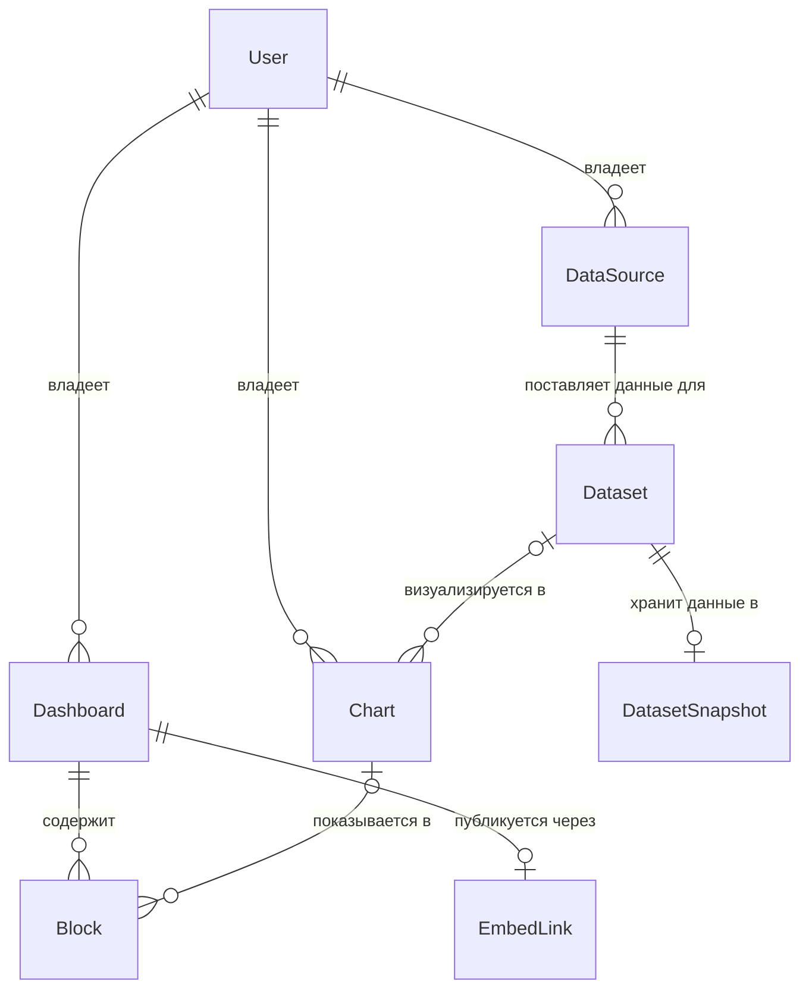

# Схема базы данных

Источник истины: [server/db/prisma/schema.prisma](../server/db/prisma/schema.prisma). PostgreSQL, Prisma 7.

Этот документ объясняет, **зачем** каждая таблица, связь и индекс устроены именно так.

## 1. Общая картина

Цепочка данных: **подключение → датасет → график → блок на дашборде**.

- **Подключение** (`DataSource`) — откуда и как получать данные. Например, «Google Таблица `Продажи 2026`».
- **Датасет** (`Dataset`) — конкретный набор данных из подключения. Например, «лист `Январь`, диапазон `A1:F500`». Из одного подключения можно сделать несколько датасетов.
- **Снимок** (`DatasetSnapshot`) — сами данные датасета, лежат отдельно от его описания.
- **График** (`Chart`) — настроенная визуализация датасета: тип, столбцы, агрегация. Создаётся один раз и ставится на любое число дашбордов.
- **Блок** (`Block`) — место на сетке дашборда. Показывает график или текст.
- **EmbedLink** — публичный доступ к дашборду для iframe, не больше одного на дашборд.

Такое разделение повторяет модель Metabase и Superset (Database → Dataset → Chart → Dashboard). Что оно даёт:
- несколько датасетов из одного документа, не вводя ссылку повторно;
- один график на нескольких дашбордах: правка графика видна везде;
- новые типы источников без изменения модели: для Postgres-подключения датасет — это SQL-запрос, для Google Sheets — лист и диапазон. Меняется только форма `config` и `query`.

## 2. Таблицы

### User
Аккаунт сервиса.

| Поле | Зачем |
|------|-------|
| `id` | `cuid`, а не автоинкремент: ID не раскрывает число пользователей и не перебирается подстановкой `1, 2, 3…` |
| `email` | Логин. Хранится в нижнем регистре (приводит код), иначе `A@x.com` и `a@x.com` станут разными аккаунтами |
| `passwordHash` | Только хэш (argon2id/bcrypt). Название поля напоминает, что пароль сюда не пишут |
| `name` | Отображаемое имя, необязательное |
| `createdAt` | Аудит |

### Dashboard
Дашборд пользователя.

| Поле | Зачем |
|------|-------|
| `ownerId` | Владелец. По нему проверяется доступ на каждом запросе |
| `title` | Название |
| `gridColumns` | Фиксированное число колонок (48). Координаты блоков хранятся в клетках, и без фиксированной ширины сетки одна и та же раскладка выглядела бы по-разному на разных экранах |
| `layoutVersion` | Оптимистичная блокировка. Клиент присылает версию, с которой начал редактирование; сохранение делает `UPDATE ... WHERE layoutVersion = N` и увеличивает её. Если две вкладки сохраняют одновременно, вторая получает конфликт, а не молча затирает первую. `updatedAt` для этого не подходит: при сохранении меняются строки `Block`, а не `Dashboard` |
| `createdAt`, `updatedAt` | Сортировка списка, аудит |

### Block
Место на сетке дашборда.

| Поле | Зачем |
|------|-------|
| `x`, `y`, `w`, `h` | Позиция и размер в клетках грида. `Int`, потому что грид дискретный; `Float` давал бы позиции «между клетками» |
| `kind` | `CHART` или `TEXT` |
| `chartId` | График для блока `CHART`. Может стать `NULL`, если график удалили |
| `text` | Текст для блока `TEXT` |

Блок хранит только «где и что показать». Настройки графика живут в `Chart`, поэтому один и тот же график на трёх дашбордах настраивается в одном месте.

### DataSource
Подключение: откуда и как получать данные.

| Поле | Зачем |
|------|-------|
| `ownerId` | Владелец. Через подключение определяется и владелец всех его датасетов |
| `name` | Название в интерфейсе |
| `type` | Пока только `GOOGLE_SHEET`. Определяет форму `config` и `query` у датасетов |
| `config` | Параметры подключения, проверяются zod по `type`. Для Google Sheets — `{ spreadsheetId }`. Храним идентификатор, а не ссылку пользователя: URL для загрузки сервер строит сам (защита от SSRF). Если появятся типы с паролями (Postgres), секреты кладутся сюда только зашифрованными |
| `ttlSeconds` | Политика обновления: через сколько снимки датасетов считаются устаревшими. Одна настройка на подключение, датасеты её наследуют |

### Dataset
Конкретный набор данных из подключения. Без самих данных.

| Поле | Зачем |
|------|-------|
| `sourceId` | Подключение, из которого берутся данные |
| `name` | Название в интерфейсе |
| `query` | Что именно взять из подключения, проверяется zod по типу подключения. Для Google Sheets — `{ gid, range?, headerRow }`: лист, необязательный диапазон и строка заголовков |
| `refreshStartedAt` | Блокировка обновления. Захватывается условным `UPDATE ... WHERE refreshStartedAt IS NULL OR refreshStartedAt < now() - timeout`: обновится ровно одна строка у одного процесса, остальные увидят 0 и не пойдут в Google. Таймаут спасает от «зависшей» блокировки, если процесс упал |
| `lastError` | Текст ошибки последнего обновления для интерфейса. Старый снимок при ошибке не трогается |

Почему у датасета нет `ownerId`: владелец определяется через `source.ownerId`. Если хранить владельца и там, и там, появляется инвариант «владелец датасета = владелец подключения», который БД не проверяет, и рано или поздно данные разойдутся.

Почему состояние обновления на датасете, а не на подключении: каждый датасет загружается отдельным запросом (свой лист или, в будущем, свой SQL), поэтому и блокировка, и ошибки у каждого свои. На подключении живёт только политика (`ttlSeconds`).

Отдельного поля статуса нет: «данные есть» = есть снимок, «идёт обновление» = выставлен `refreshStartedAt`, «последнее обновление упало» = есть `lastError`. Один enum смешивал бы эти состояния: датасет с хорошими данными после неудачного refresh выглядел бы «сломанным».

Почему нет уникальности на `query`: два датасета из одного листа с разными диапазонами — нормальный сценарий. Повтор одинакового датасета ничего не ломает, а уникальность по JSON в Postgres неудобна.

### DatasetSnapshot
Сами данные датасета, связь 1:1 с `Dataset`.

| Поле | Зачем |
|------|-------|
| `datasetId` | Одновременно первичный ключ и ссылка: снимок у датасета ровно один |
| `columns` | `[{ name, type }]` — автоопределённые типы столбцов |
| `rows` | Строки как массив массивов (компактнее, чем массив объектов: имена столбцов не повторяются) |
| `rowCount` | Чтобы показывать размер, не разбирая JSON |
| `fetchedAt` | Когда данные получены; от него и `source.ttlSeconds` считается устаревание |

Почему отдельная таблица, а не поля в `Dataset`:
- Список датасетов и захват блокировки читают и пишут `Dataset` постоянно. Если бы там лежал JSON на мегабайты, легко случайно вытащить его в `findMany`, а Postgres при каждом `UPDATE` строки пишет новую версию всей строки (MVCC), то есть каждое изменение `refreshStartedAt` копировало бы и данные.
- Отдельная таблица делает тяжёлые данные явными: их читает только тот, кто рисует графики.

### Chart
Настроенная визуализация датасета.

| Поле | Зачем |
|------|-------|
| `ownerId` | Владелец. Нужен для списка «мои графики» и проверки доступа. В отличие от датасета, график нельзя надёжно привязать к владельцу через ссылку: `datasetId` может стать `NULL` |
| `datasetId` | Какие данные показывать. Может стать `NULL`, если датасет удалили: график остаётся, его можно перепривязать |
| `name` | Название; используется и как заголовок графика |
| `type` | `BAR`, `LINE`, `PIE`, `DONUT` |
| `labelColumn`, `valueColumn` | Столбец подписей (ось X, сектора) и столбец значений. Ссылка по имени: если столбец переименуют в таблице, график покажет «столбец не найден» вместо того, чтобы молча показать не те данные (как было бы при ссылке по номеру) |
| `aggregation` | Как свести значения с одинаковой подписью: `SUM`, `AVG`, `COUNT`, `MIN`, `MAX` |
| `options` | Оформление (цвета, легенда), проверяется zod |
| `createdAt`, `updatedAt` | Аудит, сортировка |

Почему основные настройки — отдельные колонки, а оформление — JSON: тип, столбцы и агрегация есть у любого графика и определяют, какие данные считать. Типизированные колонки и enum дают проверку на уровне БД. Оформление отличается по типам графиков (у donut есть радиус, у line нет) и не влияет на данные, поэтому его проще держать в JSON.

### EmbedLink
Публичный доступ к дашборду для встраивания.

| Поле | Зачем |
|------|-------|
| `dashboardId` | Дашборд. `@unique`: одна ссылка на дашборд |
| `tokenHash` | SHA-256 от токена. Сам токен показывается владельцу один раз. Если утечёт дамп БД, по хэшу нельзя открыть дашборд. Медленный хэш (как для паролей) не нужен: токен случайный и длинный, его не подбирают по словарю |
| `allowedOrigins` | Сайты, где разрешено встраивание. Из них собирается заголовок `Content-Security-Policy: frame-ancestors` |
| `revokedAt` | Отзыв. Проверяется на каждом запросе к embed |

## 3. Связи и поведение при удалении

| Связь | Тип | `onDelete` | Почему |
|-------|-----|-----------|--------|
| User → Dashboard | 1:N | `Cascade` | Удалили аккаунт — дашборды без владельца не нужны |
| User → DataSource | 1:N | `Cascade` | То же |
| User → Chart | 1:N | `Cascade` | То же |
| DataSource → Dataset | 1:N | `Cascade` | Датасет без подключения не может обновляться. Перед удалением интерфейс показывает, что будет затронуто |
| Dataset → DatasetSnapshot | 1:0..1 | `Cascade` | Данные без описания бесполезны |
| Dataset → Chart | 1:N, необязательная | `SetNull` | Удаление датасета не должно удалять настроенные графики: график остаётся и показывает «нет данных», его можно привязать к другому датасету |
| Chart → Block | 1:N, необязательная | `SetNull` | Удаление графика не должно ломать раскладку дашбордов: блок остаётся на месте пустым |
| Dashboard → Block | 1:N | `Cascade` | Блок не существует вне дашборда |
| Dashboard → EmbedLink | 1:0..1 | `Cascade` | Удалили дашборд — публичная ссылка должна перестать работать сразу |

Цепочка при удалении подключения: `DataSource` → (Cascade) его датасеты → (Cascade) их снимки и (SetNull) ссылки в графиках. Графики и дашборды остаются целыми.

Почему `Cascade`, а не `Restrict` для DataSource → Dataset: при `Restrict` удаление пользователя упиралось бы в его датасеты, и пришлось бы удалять всё вручную в правильном порядке. Защиту от случайного удаления лучше делать в интерфейсе (подтверждение со списком затронутого), а не в БД.

Почему не many-to-many (как было в первой версии схемы): блок показывает один график, график строится по одному датасету. Неявные таблицы связей между `Block`, `ContentBlock` и `Chart` разрешали бы блоку иметь несколько контентов, чего продукт не предполагает. Лишняя свобода в схеме — это состояния, которые код обязан обрабатывать.

## 4. Индексы

Важная особенность Postgres: **внешний ключ не создаёт индекс автоматически** (в отличие, например, от MySQL). Индекс создаётся только для первичного ключа и `UNIQUE`. Поэтому индексы на ссылочные поля приходится объявлять явно.

| Индекс | Какой запрос ускоряет |
|--------|----------------------|
| `User.email` (`@unique`) | Вход: поиск пользователя по email. Уникальность защищает от двух аккаунтов на один email даже при одновременной регистрации (проверка в коде такую гонку не ловит) |
| `Dashboard.ownerId` | Список «мои дашборды». Без индекса — полный проход по таблице всех пользователей. Также каскадное удаление пользователя |
| `DataSource.ownerId` | Список «мои подключения» и первый шаг списка «мои датасеты». Также каскадное удаление пользователя |
| `Dataset.sourceId` | Датасеты подключения; второй шаг списка «мои датасеты»; каскадное удаление подключения |
| `Chart.ownerId` | Список «мои графики» (выбор графика для блока). Также каскадное удаление пользователя |
| `Chart.datasetId` | Удаление датасета: Postgres ищет все графики со ссылкой на него, чтобы выставить `NULL`. Также «где используется датасет» перед удалением |
| `Block.dashboardId` | Загрузка дашборда: все его блоки. Самый частый запрос в системе (редактор и каждый просмотр embed). Также каскадное удаление дашборда |
| `Block.chartId` | Удаление графика (`SET NULL` в блоках) и «на каких дашбордах стоит график» перед удалением. Без индекса каждое такое действие сканирует все блоки всех пользователей |
| `DatasetSnapshot.datasetId` (PK) | Получение данных датасета; гарантирует 1:1 |
| `EmbedLink.tokenHash` (`@unique`) | Главный запрос embed: открыли `/embed/<token>` → хэшируем → ищем. Уникальность исключает коллизию двух дашбордов на одном токене |
| `EmbedLink.dashboardId` (`@unique`) | Настройки embed в редакторе; гарантирует одну ссылку на дашборд |

Про составные индексы: B-tree индекс по `(a, b)` работает и для запросов только по `a` (левый префикс), но не только по `b`. Поэтому при появлении составного индекса, начинающегося с того же поля, отдельный одиночный индекс становится дублем, который лишь замедляет вставки.

Чего сознательно нет:
- Индексов на `x/y`, `createdAt`, `name` и т. п. Блоки дашборда загружаются целиком (их десятки), сортировка в памяти дешевле поддержки индекса.
- GIN-индексов на JSON (`config`, `query`, `options`, `rows`). Мы не ищем по содержимому JSON в SQL: данные читаются целиком и агрегируются в коде.
- Индекса на `Dataset.refreshStartedAt`. Обновление ленивое (по запросу конкретного датасета, по первичному ключу), фонового «найти все устаревшие» нет. Если появится cron, понадобится индекс под его запрос.

## 5. Что схема не гарантирует

Эти правила проверяются в коде и должны быть покрыты тестами. Пункты 1–3 — защита от IDOR (доступа к чужим данным подстановкой ID), это самые важные проверки в системе.

1. **Доступ к датасету только через владельца подключения.** Любой запрос к датасету проверяет `source.ownerId`, например `dataset.findFirst({ where: { id, source: { ownerId } } })`.
2. **График строится только по своему датасету.** При создании и смене датасета: `dataset.source.ownerId` = `chart.ownerId`.
3. **Блок показывает только свой график.** При добавлении графика на дашборд: `chart.ownerId` = `dashboard.ownerId`.
4. **У блока `CHART` есть `chartId`, у `TEXT` есть `text`** при создании (после удаления графика `NULL` допустим).
5. **`config`, `query` и `options` соответствуют своему типу** — zod.
6. **Email в нижнем регистре** — нормализация перед записью и поиском. Альтернатива — тип `citext`.
7. **Блоки не пересекаются** — это инвариант логики грида, а не БД.

Для embed проверки 2–3 особенно важны: публичная страница отдаёт данные по цепочке «дашборд → блоки → графики → снимки», и любая чужая ссылка в этой цепочке стала бы публичной утечкой.

## 6. Типичные запросы

| Сценарий | Запрос | Индекс |
|----------|--------|--------|
| Вход | `User WHERE email = ?` | `email` unique |
| Мои дашборды | `Dashboard WHERE ownerId = ?` | `Dashboard.ownerId` |
| Мои датасеты | `Dataset JOIN DataSource ON sourceId WHERE DataSource.ownerId = ?` | `DataSource.ownerId`, `Dataset.sourceId` |
| Мои графики | `Chart WHERE ownerId = ?` | `Chart.ownerId` |
| Открыть дашборд | `Dashboard WHERE id = ? AND ownerId = ?` → `Block WHERE dashboardId = ?` → их графики → снимки датасетов | PK, `Block.dashboardId`, PK графика, PK снимка |
| Сохранить раскладку | транзакция: `UPDATE Dashboard SET layoutVersion = N+1 WHERE id = ? AND layoutVersion = N` → если обновлено 0 строк, конфликт; иначе обновить блоки | PK |
| Открыть embed | `EmbedLink WHERE tokenHash = ? AND revokedAt IS NULL` → блоки → графики → снимки | `tokenHash` unique, `Block.dashboardId` |
| Захватить refresh | `UPDATE Dataset SET refreshStartedAt = now() WHERE id = ? AND (refreshStartedAt IS NULL OR refreshStartedAt < ?)` | PK |
| Где стоит график | `Block WHERE chartId = ?` | `Block.chartId` |
| Удалить датасет | `DELETE Dataset WHERE id = ?` → каскад на снимок, `SET NULL` в графиках | `Chart.datasetId` |

## 7. Возможные расширения

Отложено сознательно, добавлять при реальной необходимости:

- **Отзыв всех сессий** («выйти на всех устройствах», смена пароля): `User.tokenVersion`, записывается в JWT и сверяется при проверке сессии.
- **Ручная правка типов столбцов:** `Dataset.columnOverrides` — отдельно от снимка, чтобы правки переживали refresh.
- **Backoff при ошибках обновления:** `Dataset.nextRetryAt` и `failCount`, чтобы не обращаться к закрытой таблице на каждый просмотр.
- **Пропуск неизменных данных:** `DatasetSnapshot.contentHash` — не переписывать снимок, если CSV не изменился.
- **Новые типы подключений** (Postgres, CSV-загрузка): новое значение в `SourceType` и новые zod-схемы для `config` и `query`. Модель не меняется. Для подключений с паролями — шифрование `config`.
- **Раскладки под брейкпоинты:** таблица `BlockLayout(blockId, breakpoint, x, y, w, h)` с `@@unique([blockId, breakpoint])`.
- **Несколько embed-ссылок на дашборд:** убрать `@unique` с `EmbedLink.dashboardId`, добавить `@@index([dashboardId])`.
- **История снимков:** снять 1:1, хранить последние N версий с `@@index([datasetId, fetchedAt])`.
